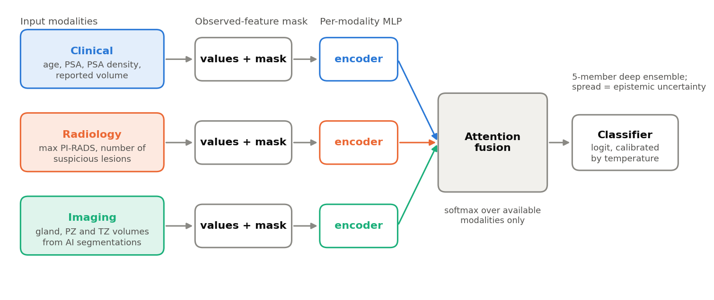
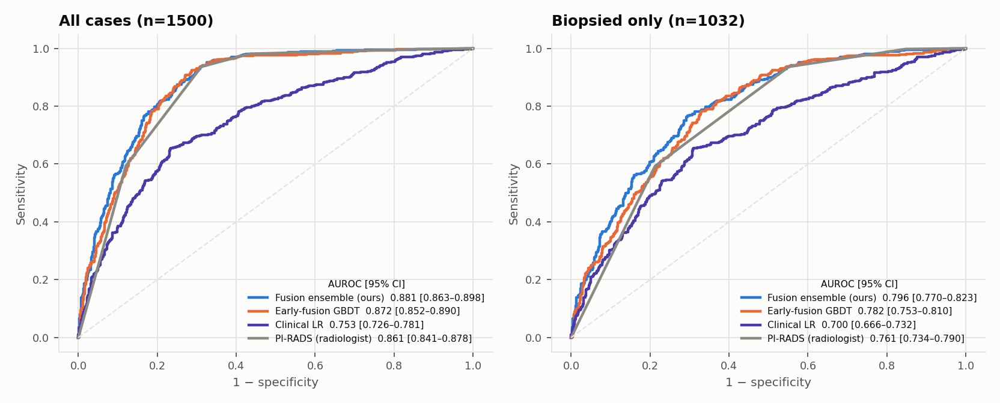
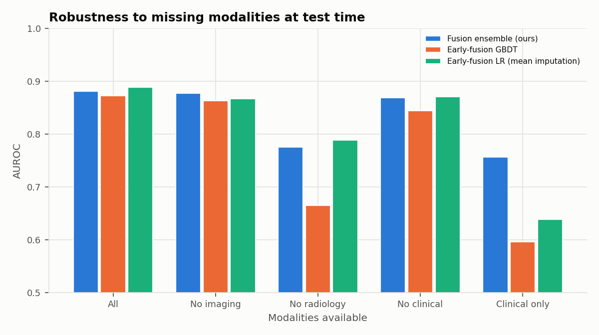
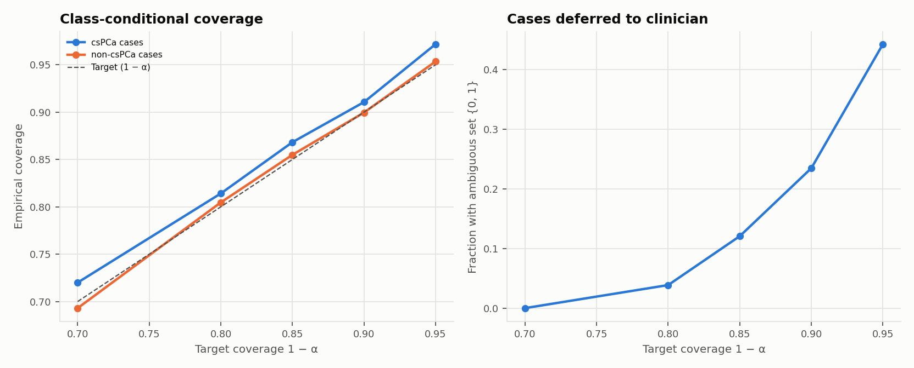
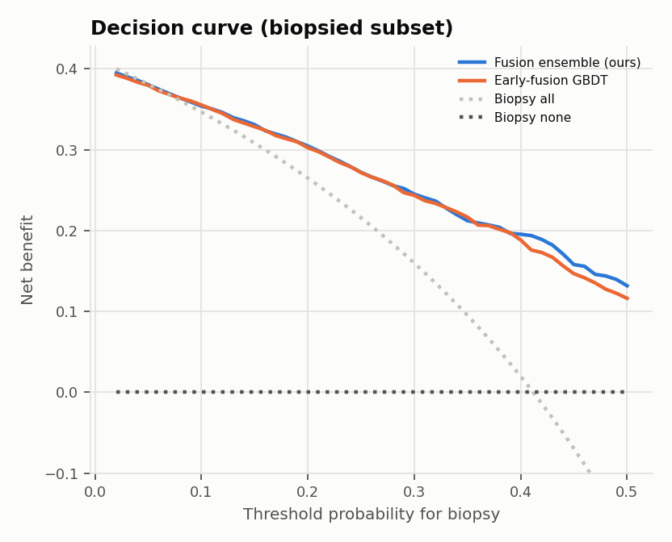
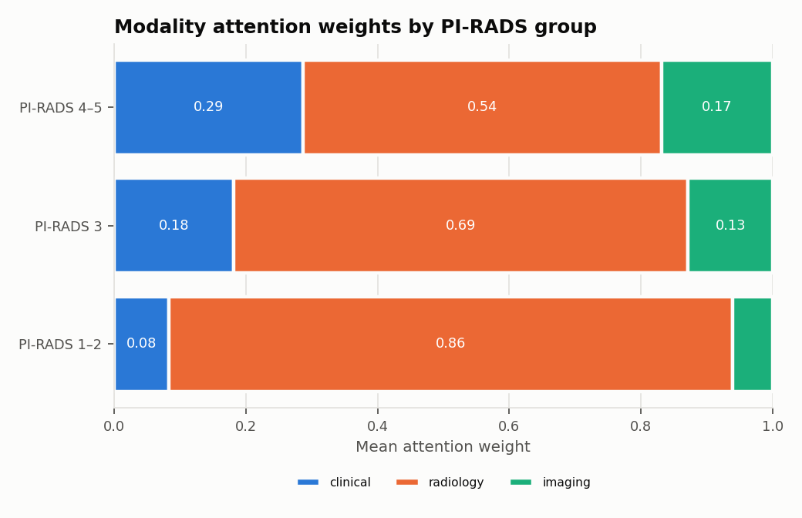
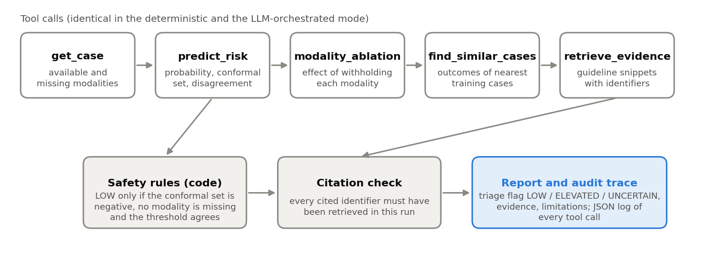

# Robust multimodal risk estimation for prostate cancer

A missing-modality-aware fusion model, calibrated uncertainty and an auditable decision-support agent for the detection of clinically significant prostate cancer, developed on the public PI-CAI dataset.

*Research code. Not intended for clinical use.*

## Abstract

Clinical prediction models are usually developed on complete data. At the point of care, however, a laboratory value, a radiology report or an imaging study is often unavailable. This project asks how a multimodal model should behave in that situation, and how its uncertainty can be made explicit enough to support, rather than replace, a clinical decision.

Using 1,500 prostate MRI studies from the PI-CAI public dataset, I combine three groups of information to estimate the probability of clinically significant prostate cancer (csPCa, ISUP grade group 2 or higher):
- clinical variables;
- the radiologist's PI-RADS assessment;
- anatomical volumes derived from MRI segmentations.

The fusion network encodes each modality separately. It weights the modalities that are actually present with an attention mechanism, and it is trained with modality dropout. Uncertainty is quantified with a deep ensemble, temperature scaling and class-conditional conformal prediction.

On complete data, the model performs on par with a regularised logistic regression (AUROC 0.881 against 0.889). When modalities are removed at test time, it degrades far less: with clinical data alone it reaches 0.756, against 0.638 for logistic regression and 0.596 for gradient boosting. The conformal sets reach their nominal coverage for both classes. Performance holds under leave-one-center-out validation.

A tool-using agent turns these outputs into a structured report. The report carries a triage flag, the evidence behind it, and a full trace of every computation. The agent refuses to issue a confident negative when the statistical guarantee no longer applies.

## 1. Data

The data come from the public training and development set of the PI-CAI challenge (Saha et al., 2024). They comprise 1,500 biparametric MRI studies from 1,476 patients, acquired at three Dutch centres (Radboudumc, Ziekenhuisgroep Twente and Prostaat Centrum Noord-Nederland). Of these studies, 28.3% contain csPCa. Only the clinical information sheet and the released segmentation masks are used; the MRI volumes themselves are not downloaded.

The variables are grouped into three modalities, shown in Table 1. Imaging volumes were computed from the AI-generated whole-gland (Bosma22b) and zonal (Yuan23) masks, using the voxel spacing stored in each file. As a check of this extraction, the gland volume obtained from the masks agrees closely with the volume reported by the radiologist (Spearman ρ = 0.89).

*Table 1. Modalities and features.*

| Modality | Features | Missing values |
|---|---|---|
| Clinical | age, PSA (log-transformed), reported PSA density, reported prostate volume | PSA density absent in 30% of studies |
| Radiology | maximum PI-RADS score, number of lesions scored 3 or higher, indicator of PI-RADS 4 or 5 | none |
| Imaging | whole-gland, peripheral-zone and transition-zone volumes, transition-zone fraction | none |

Three properties of the dataset shaped the design:

1. **Label leakage.** The csPCa lesion masks exist only for positive cases, so they are never used as inputs.
2. **Repeated studies.** Several patients have more than one study. Every split is therefore grouped by patient.
3. **Verification bias.** Studies scored PI-RADS 1 or 2 were labelled negative on MRI alone, without biopsy; none of the 468 non-biopsied studies is positive. Performance on the full dataset therefore partly rewards the model for reproducing the reference standard. Every result is also reported on the 1,032 biopsied studies, where the clinical question is genuinely open.

## 2. Methods

### 2.1 Fusion model

Figure 1 shows the architecture.
- **Inputs.** Each modality is represented by its standardised feature values, concatenated with a binary mask marking which values were observed, so that missing features are encoded explicitly instead of being imputed.
- **Encoders.** A small two-layer network encodes each modality into a 32-dimensional embedding.
- **Fusion.** An attention layer scores each embedding, and a softmax restricted to the modalities present in the case turns the scores into weights. An absent modality therefore receives a weight of exactly zero and has no influence on the prediction.
- **Training.** Whole modalities are randomly dropped with probability 0.3, so that the network learns to predict from any subset of its inputs.



*Figure 1. Architecture of the fusion model. Each modality is encoded separately; the attention weights are computed only over the modalities available for the case.*

### 2.2 Uncertainty

Uncertainty is quantified in three layers:

- **Deep ensemble.** Five independently initialised networks are trained. The spread of their predictions serves as an estimate of epistemic uncertainty.
- **Calibration.** The averaged logit is calibrated by temperature scaling (Guo et al., 2017).
- **Conformal prediction.** On top of the calibrated probabilities, I use split conformal prediction in its class-conditional (Mondrian) form. It guarantees coverage separately for csPCa and non-csPCa cases, not only on average. For the positive class, this is a distribution-free guarantee on sensitivity.

Each case therefore receives one of three prediction sets:
- a confident negative;
- a confident positive;
- an ambiguous set containing both outcomes, in which case it is deferred to a clinician.

### 2.3 Evaluation protocol

**Cross-validation.** The main estimates come from five-fold cross-validation, stratified by outcome and grouped by patient. Within each training fold, 20% of patients are held out as a calibration set. This set is used for early stopping, temperature scaling, conformal calibration and the choice of operating threshold; the test fold is never touched.

**Leave-one-center-out validation.** A second protocol trains on two centres and tests on the third, to assess transfer between sites.

**Metrics.** Discrimination is summarised by the AUROC, with 95% confidence intervals from a bootstrap that resamples patients. Calibration is measured by the Brier score and the expected calibration error (ECE). Clinical utility is assessed with decision curves (Vickers and Elkin, 2006).

**Comparators.** The model is compared with four baselines:
- the PI-RADS score used directly as a risk score;
- a logistic regression on clinical variables only;
- an early-fusion logistic regression on all features, with mean imputation;
- an early-fusion gradient boosting model, which handles missing values natively.

## 3. Results

### 3.1 Discrimination and calibration

Table 2 reports out-of-fold performance.

**Complete data.** With all modalities present, the fusion model and the early-fusion logistic regression are not distinguishable: their confidence intervals overlap almost entirely. With 11 tabular features and 1,500 cases, a well-regularised linear model is a strong baseline, and I do not claim an advantage here.

**Biopsied studies.** On the 1,032 biopsied studies, combining the clinical and imaging variables with PI-RADS improves on PI-RADS alone (0.796 to 0.808 against 0.761).

*Table 2. Out-of-fold discrimination and calibration. Brier score and ECE are not reported for PI-RADS, which is an ordinal score rather than a probability.*

| Model | AUROC, all studies (n = 1,500) | AUROC, biopsied (n = 1,032) | Brier | ECE |
|---|---|---|---|---|
| PI-RADS alone | 0.861 (0.841 to 0.878) | 0.761 (0.734 to 0.790) | | |
| Clinical logistic regression | 0.753 (0.726 to 0.781) | 0.700 (0.666 to 0.732) | 0.169 | 0.022 |
| Early-fusion logistic regression | 0.889 (0.870 to 0.905) | 0.808 (0.783 to 0.834) | 0.122 | 0.027 |
| Early-fusion gradient boosting | 0.872 (0.852 to 0.890) | 0.782 (0.753 to 0.810) | 0.131 | 0.042 |
| Fusion ensemble (this work) | 0.881 (0.863 to 0.898) | 0.796 (0.770 to 0.823) | 0.125 | 0.026 |



*Figure 2. ROC curves from five-fold cross-validation, on all studies (left) and on biopsied studies only (right).*

### 3.2 Robustness to missing modalities

To test robustness, entire modalities were removed at test time from models trained on complete data (Table 3, Figure 3).

The early-fusion models depend heavily on whichever input dominates their training. When it is missing, they degrade sharply: with clinical variables alone, the logistic regression falls to 0.638 and gradient boosting to 0.596. The fusion model falls back on the remaining evidence and keeps an AUROC of 0.756. This is essentially the level of a model trained on clinical data only (0.753), obtained without training a separate model for each pattern of missingness.

The one scenario where the logistic regression remains slightly ahead is the absence of the radiology report (0.788 against 0.775).

*Table 3. AUROC when whole modalities are unavailable at test time.*

| Modalities available | Fusion ensemble | Early-fusion logistic regression | Early-fusion gradient boosting |
|---|---|---|---|
| All | 0.881 | 0.889 | 0.872 |
| No imaging | 0.877 | 0.867 | 0.863 |
| No clinical | 0.868 | 0.871 | 0.844 |
| No radiology | 0.775 | 0.788 | 0.665 |
| Clinical only | 0.756 | 0.638 | 0.596 |



*Figure 3. AUROC of each model when modalities are withheld at test time.*

### 3.3 Uncertainty

**Coverage.** The class-conditional conformal sets reach their nominal coverage for both classes (Table 4, Figure 4). At a target of 90%, they contain the true label for 91.1% of csPCa cases and 90.0% of other cases.

**Price of the guarantee.** At this level, 23.5% of studies receive an ambiguous set and would be referred for review.

**Quality of the referrals.** The deferred cases are genuinely difficult: the error rate of the underlying classifier is 41% among them, compared with 13% among the cases the model resolves on its own. The disagreement between ensemble members carries the same signal, identifying misclassified cases with an AUROC of 0.77.

*Table 4. Empirical coverage of class-conditional conformal prediction and fraction of studies deferred.*

| Target coverage | Coverage, csPCa | Coverage, non-csPCa | Deferred |
|---|---|---|---|
| 80% | 81.4% | 80.5% | 3.9% |
| 90% | 91.1% | 90.0% | 23.5% |
| 95% | 97.2% | 95.3% | 44.3% |



*Figure 4. Empirical coverage per class (left) and fraction of studies with an ambiguous prediction set (right), as a function of the target coverage.*

### 3.4 Clinical utility

On the biopsied studies, I compared biopsy strategies built on PI-RADS, PSA density and the model (Table 5).

**Operating threshold.** The model threshold was chosen on the calibration set to reach 95% sensitivity. On unseen data it reached only 92.7%: a single threshold estimated from a few hundred cases does not transfer exactly. This is one of the reasons the agent described in Section 4 relies on conformal sets rather than on a fixed cut-off.

**Comparison with PI-RADS.** At that threshold, the model avoids about the same proportion of biopsies as the rule "biopsy if PI-RADS is 4 or 5", with similar sensitivity.

**Decision curve.** The model's net benefit exceeds that of biopsying every patient across the range of thresholds usually considered in practice (Figure 5).

*Table 5. Biopsy strategies on the biopsied subset (n = 1,032).*

| Strategy | Sensitivity | Specificity | Biopsies avoided |
|---|---|---|---|
| Biopsy if PI-RADS 3 or higher | 0.981 | 0.231 | 14.3% |
| Biopsy if PI-RADS 4 or 5, or PI-RADS 3 with PSA density of 0.15 or more | 0.965 | 0.333 | 21.0% |
| Biopsy if PI-RADS 4 or 5 | 0.936 | 0.448 | 29.0% |
| Fusion model, threshold set for 95% sensitivity | 0.927 | 0.450 | 29.5% |



*Figure 5. Decision curve on the biopsied subset.*

### 3.5 Transfer between centres

In leave-one-center-out validation (Table 6), the fusion model is the best or tied for best on each held-out centre. All models perform noticeably worse on PCNN, which suggests a shift at the level of the centre (scanners, referral population, reporting habits) rather than a weakness specific to one method.

*Table 6. AUROC on each held-out centre.*

| Held-out centre | Studies | Prevalence | PI-RADS | Logistic regression | Gradient boosting | Fusion ensemble |
|---|---|---|---|---|---|---|
| PCNN | 350 | 31% | 0.788 | 0.798 | 0.759 | 0.794 |
| RUMC | 800 | 30% | 0.875 | 0.897 | 0.871 | 0.903 |
| ZGT | 350 | 23% | 0.894 | 0.910 | 0.895 | 0.911 |

### 3.6 Attention weights

Figure 6 shows how the model distributes its attention across modalities as a function of the PI-RADS score:
- for PI-RADS 1 or 2, it relies almost entirely on the radiology report;
- for PI-RADS 4 or 5, it gives more weight to PSA, PSA density and prostate anatomy.

This pattern is consistent with clinical practice, where secondary factors are used to refine the assessment of suspicious lesions. Attention weights describe what the model uses; they are not a causal explanation.



*Figure 6. Mean attention weight per modality, grouped by maximum PI-RADS score.*

## 4. Decision-support agent

The model's outputs are made usable through an agent that calls a fixed set of tools and assembles a report (Figure 7):
- `get_case` reads the case and lists missing modalities;
- `predict_risk` returns the calibrated probability, the conformal set and the ensemble disagreement;
- `modality_ablation` measures how the estimate changes when each modality is withheld;
- `find_similar_cases` retrieves the outcomes of the most similar training cases;
- `retrieve_evidence` searches a small curated base of guideline statements (EAU guidelines, PI-RADS v2.1, the PRECISION trial, the PI-CAI study and literature on PSA density).

The same tools can be run in a fixed order, or orchestrated by a language model (Claude, through the Anthropic API).



*Figure 7. Tool calls and safeguards of the decision-support agent.*

The agent never recommends a biopsy or a treatment. It assigns one of three flags: low, elevated or uncertain. Two safeguards, implemented in code and covered by unit tests, constrain this output:

1. **A low flag requires the conformal guarantee to hold.** The conformal sets were calibrated on complete cases, so the guarantee does not apply when a modality is missing. In that situation, or when the probability exceeds the 95%-sensitivity threshold while the conformal set is negative, the case is flagged as uncertain.
2. **Every citation must be grounded.** Each reference in a report must correspond to a snippet actually retrieved during that run. In the language-model mode, a failed check triggers a revision, and the flag is always recomputed from the tool outputs rather than read from the generated text.

**Evaluation on unseen patients.** For evaluation, 30 patients (31 studies) were excluded from training. Among the 15 studies flagged low, one had csPCa: a lesion invisible on MRI and scored PI-RADS 2. The other seven csPCa cases were flagged elevated (3) or uncertain (4).

**Behaviour with a missing modality.** When the radiology report was removed from every case, no study was flagged low: the agent referred the cases instead of issuing confident negatives. An example report is available in [outputs/reports/10636_1000652.md](outputs/reports/10636_1000652.md), together with its execution trace.

## 5. Limitations

**Imaging content.** The imaging modality consists of anatomical volumes derived from segmentations, not of representations learned from the MRI signal. Most of the imaging information therefore reaches the model through the radiologist's PI-RADS score.

**Dataset.** The data are retrospective, come from three centres in a single country, and carry verification bias for low PI-RADS scores. The PI-CAI maintainers also note that the released PI-RADS scores come from convenience sampling and should not be used to benchmark AI against radiologists; the PI-RADS results above are a reference, not a head-to-head comparison.

**Missing data types.** The dataset contains no PET imaging, no histopathology images and too few repeated studies (24 patients) for longitudinal modelling.

**Evidence base.** The evidence base consists of a dozen paraphrased statements, not a retrieval system over full guideline documents.

**Exchangeability.** Conformal guarantees assume that calibration and test data are exchangeable. The leave-one-center-out results show that this assumption does not hold across centres.

## 6. Future work

The fusion design is intended to accommodate richer inputs:
- image encoders for biparametric MRI;
- PET/CT and whole-slide histopathology as additional modality branches;
- longitudinal models of PSA kinetics and repeated imaging, relevant for active surveillance.

On the uncertainty side, a natural next step is conformal prediction that remains valid across centres and patterns of missingness, for example through weighting or through calibration within groups defined by centre and available modalities.

For decision support, the most important step is an evaluation with clinicians, measuring usefulness, over-reliance and the quality of deferrals rather than AUROC alone.

## 7. Reproducing the results

The full pipeline runs on a laptop CPU in about two minutes.

```bash
python -m venv .venv && source .venv/bin/activate
pip install -r requirements.txt
git clone --depth 1 https://github.com/DIAGNijmegen/picai_labels.git data/raw/picai_labels

python scripts/extract_imaging_features.py   # volumes from the segmentation masks
python scripts/run_experiments.py            # all experiments, tables and figures
python scripts/train_final_model.py          # model used by the agent
python scripts/run_agent.py --demo           # agent on the held-out patients
pytest -q                                    # unit tests
```

The language-model mode of the agent is run with `python scripts/run_agent.py --case 10636_1000652 --llm` and requires an Anthropic API key.

**Code organisation.** The code is organised as a small package in `src/pcafusion`:
- `data.py`: data loading;
- `models.py`: the fusion model;
- `baselines.py`: comparison models;
- `uncertainty.py`: calibration and conformal prediction;
- `evaluation.py`: metrics;
- `agent/`: the decision-support agent.

The scripts in `scripts/` reproduce every table and figure.

## References

Guo C, Pleiss G, Sun Y, Weinberger KQ. On calibration of modern neural networks. *ICML*, 2017.

Kasivisvanathan V, Rannikko AS, Borghi M, et al. MRI-targeted or standard biopsy for prostate-cancer diagnosis. *New England Journal of Medicine*, 2018; 378: 1767–1777.

Mottet N, Cornford P, van den Bergh RCN, et al. EAU-EANM-ESTRO-ESUR-ISUP-SIOG Guidelines on Prostate Cancer. European Association of Urology.

Saha A, Bosma JS, Twilt JJ, et al. Artificial intelligence and radiologists in prostate cancer detection on MRI (PI-CAI): an international, paired, non-inferiority, confirmatory study. *Lancet Oncology*, 2024; 25: 879–887.

Turkbey B, Rosenkrantz AB, Haider MA, et al. Prostate Imaging Reporting and Data System version 2.1. *European Urology*, 2019; 76: 340–351.

Vickers AJ, Elkin EB. Decision curve analysis: a novel method for evaluating prediction models. *Medical Decision Making*, 2006; 26: 565–574.

Vovk V, Gammerman A, Shafer G. *Algorithmic Learning in a Random World*. Springer, 2005.

The PI-CAI annotations are distributed under the CC BY-NC 4.0 licence and are not included in this repository.
